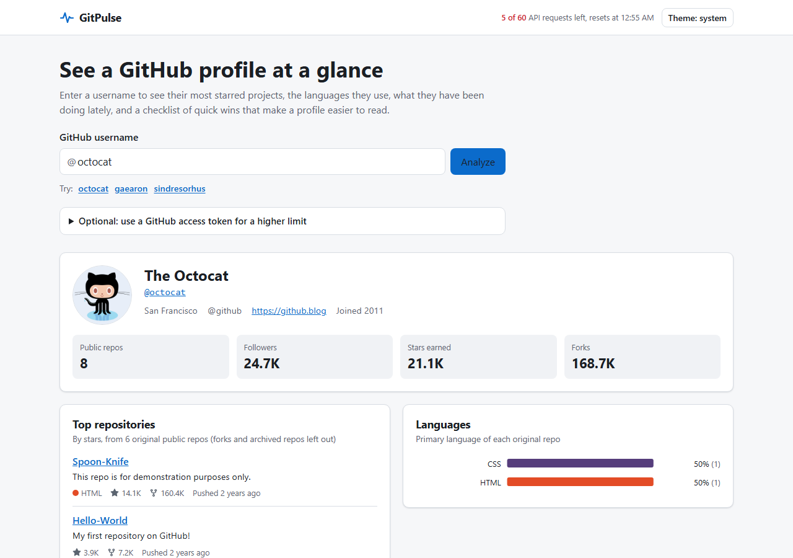

# GitPulse

**Type in someone's GitHub username and get a one-page summary of their public work.**

Live site: **https://gitpulse-sigma-red.vercel.app**

GitHub is where many developers keep their code. A profile can hold dozens of projects, and it is hard to tell at a glance what someone works on, whether they are still active, or whether their profile is easy for a visitor to understand. GitPulse reads the public information GitHub already shows and puts it on one page:

- which of their projects are the most popular,
- which programming languages they use most,
- what they have done on GitHub over the last few weeks,
- and a short checklist of easy fixes that make a profile clearer (a bio, a profile README, descriptions and licenses on the main projects).

You do not need an account or a login. Nothing is sent anywhere except to GitHub itself.



---

## What each section shows

| Section | What it tells you | Where the numbers come from |
| --- | --- | --- |
| Profile header | Name, bio, location, followers, total stars and forks | `GET /users/{name}` plus the repo list |
| Top repositories | Up to 6 original repos, ranked by stars, then forks, then last push | `GET /users/{name}/repos` (up to 3 pages of 100) |
| Languages | Share of original repos per primary language, as an SVG bar chart | The `language` field of each repo |
| Activity | Events per day for the last 30 days, event types, the 8 most recent events | `GET /users/{name}/events/public` (latest 100) |
| Profile health | 8 checks with a score out of 100 and a tip for each missing item | All of the above, plus `GET /repos/{name}/{name}/readme` when that repo exists |

"Original" means forks and archived repos are left out, so the numbers reflect work the person owns.

## Limits worth knowing

These come from GitHub's API, and the app says so on screen rather than hiding them:

- **60 requests per hour without a token.** One profile costs 3 to 6 requests. When the limit runs out, GitPulse shows the exact time it resets (from the `x-ratelimit-reset` header) and keeps the retry button disabled until then. The header bar always shows how many requests are left.
- **The activity feed is short.** GitHub only returns public events from roughly the last 90 days, and GitPulse reads the latest 100. Private contributions never appear. The timeline is a view of recent public events, not a full contribution graph.
- **Languages are by repo count, not lines of code.** Getting byte counts would cost one extra request per repo, which would use up the hourly limit on a single profile.
- **"Showcase repos" are a guess.** Pinned repos are only available through GitHub's GraphQL API, which always needs a token, so the health checks use the top 6 original repos by stars as a stand-in.
- Organisation accounts are not supported; only personal profiles.

## The optional token

If you hit the limit, you can paste a GitHub personal access token to raise it to 5,000 requests per hour. A fine-grained token with no extra permissions is enough, because everything GitPulse reads is public.

The token is kept in React state only. It is never written to `localStorage`, `sessionStorage`, cookies or the URL, so reloading the page forgets it. It is sent only to `api.github.com`, as an `Authorization` header. A unit test checks that it does not end up in storage or the URL.

## How it works

```
Browser
 ├─ SearchForm ─ validates the username, writes ?user=name to the URL (shareable, back button works)
 ├─ TanStack Query hooks (src/hooks.ts)
 │    user ─┬─> repos   (paginated)
 │          ├─> events
 │          └─> profile README check (404 = missing)
 ├─ githubGet (src/api/client.ts)
 │    ├─ sessionStorage cache, 10 minute TTL, survives quota errors
 │    ├─ reads x-ratelimit-* headers into a tiny store the header bar subscribes to
 │    └─ turns 404 / 401 / 403+429 into NotFoundError / BadTokenError / RateLimitError
 └─ pure functions in src/lib/ for ranking, language shares, daily buckets and health checks
```

Design choices:

- **No backend.** The GitHub API allows cross-origin requests, so the browser calls it directly. That keeps the token out of any server and makes hosting a static file deploy.
- **Requests only after the user lookup succeeds.** A typo costs one request, not four.
- **Rate limit, not found and bad token errors are not retried**; other errors are retried once.
- **Charts are hand-written SVG** with percentage-based coordinates, so they stay sharp at any width without a chart library. Each chart has a `<title>` and a text description for screen readers.
- **Light and dark themes** follow the system setting by default, with a manual toggle stored in `localStorage` (only the theme choice is stored).
- **Content Security Policy** in `vercel.json` only allows scripts and styles from the site itself, images from GitHub's avatar host, and network requests to `api.github.com`.

## Tests

| Kind | Tool | What is covered |
| --- | --- | --- |
| Unit | Vitest + jsdom | Formatting, cache expiry and quota handling, error mapping, pagination cap, username rules, ranking, language shares, daily buckets, health checks |
| Component | Testing Library, mocked `fetch` | Each section, the search form, token panel, theme toggle, error states with a fake clock |
| Integration | Testing Library | The whole app: search, URL sync, not found, rate limit then recovery with a token |
| End to end | Playwright (desktop and mobile Chrome) | A real build served by `vite preview`, with GitHub responses for `octocat` replayed from `e2e/fixtures.json`; also checks there are no console errors |

97 unit, component and integration tests, plus 2 Playwright tests run on two viewports. CI on every push runs lint, type checking, unit tests, the build, `npm audit --audit-level=high`, and the Playwright tests inside the official Playwright container.

The fixtures were recorded from the real API with `npm run fixtures` (it uses 4 requests; set `GITHUB_TOKEN` to use a token instead). The `octocat` account had no recent public events when they were recorded, so the end-to-end test checks the empty activity state; the filled timeline is covered by component tests.

## Run it locally

Requires Node 22.

```bash
git clone https://github.com/Mdjamilh/gitpulse.git
cd gitpulse
npm ci
npm run dev            # http://localhost:5173
```

Other scripts:

```bash
npm test               # unit, component and integration tests
npm run lint
npm run typecheck
npm run build          # production build into dist/
npx playwright install chromium
npm run test:e2e       # builds, serves on port 47210, runs the smoke tests
npm run fixtures       # re-record e2e/fixtures.json from the live API
```

## Project layout

```
src/
  api/          GitHub client, cache, endpoints, response types
  lib/          pure logic: repos, languages, activity, health, formatting
  components/   one file per section, each with its own test
  hooks.ts      TanStack Query hooks and the shared QueryClient settings
  token.tsx     in-memory token context
e2e/            Playwright smoke test and recorded fixtures
scripts/        fixture recorder
```

## Stack

Vite 7, React 19, TypeScript, TanStack Query 5, plain CSS with custom properties. Tested with Vitest, Testing Library and Playwright. Deployed on Vercel.

## License

MIT. See [LICENSE](LICENSE). Not affiliated with GitHub.
